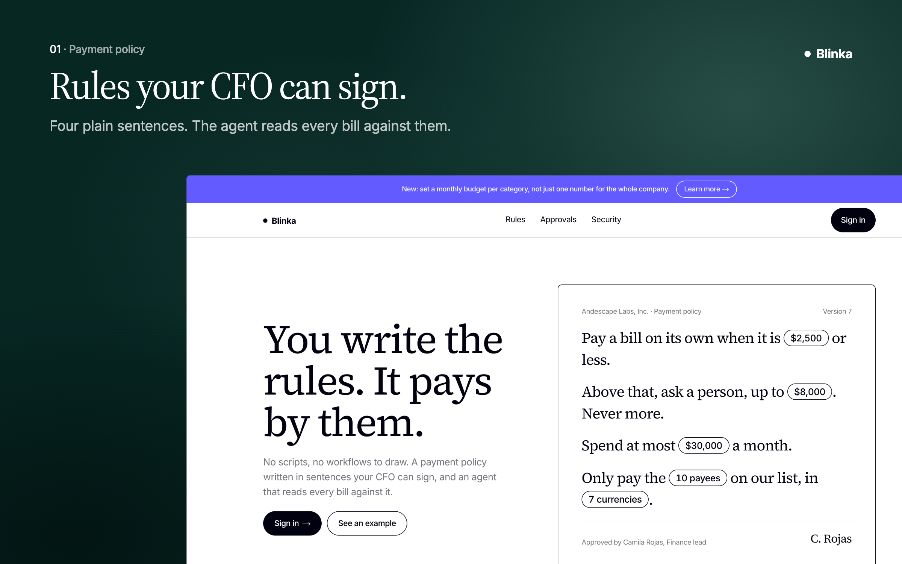
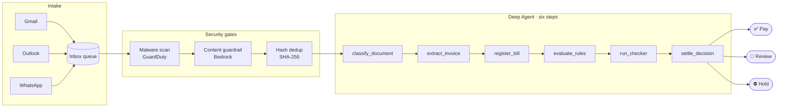
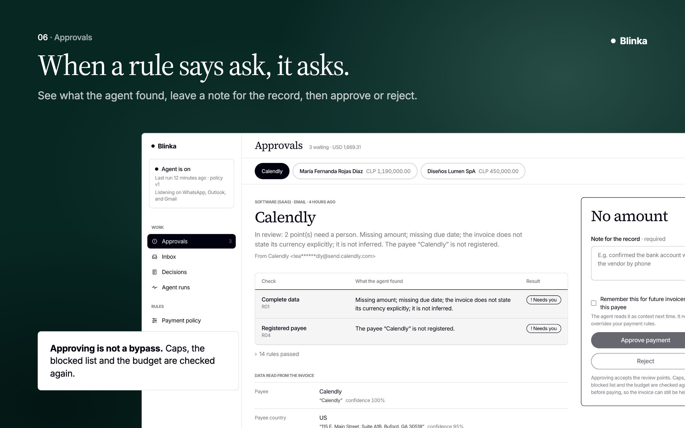
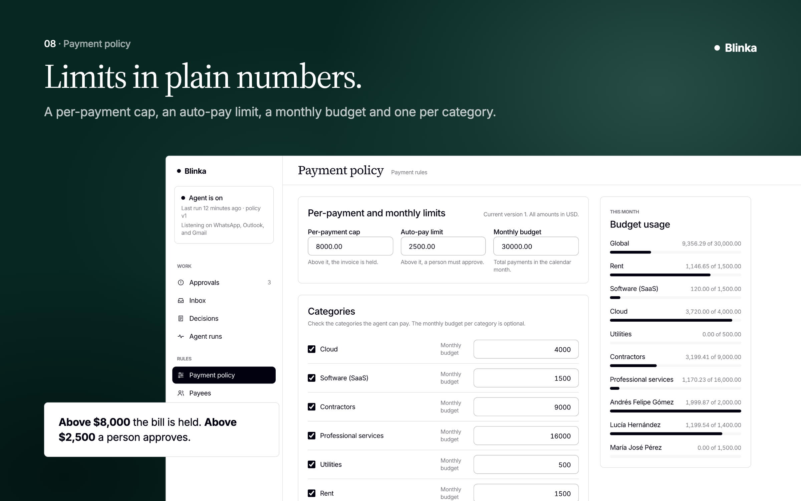
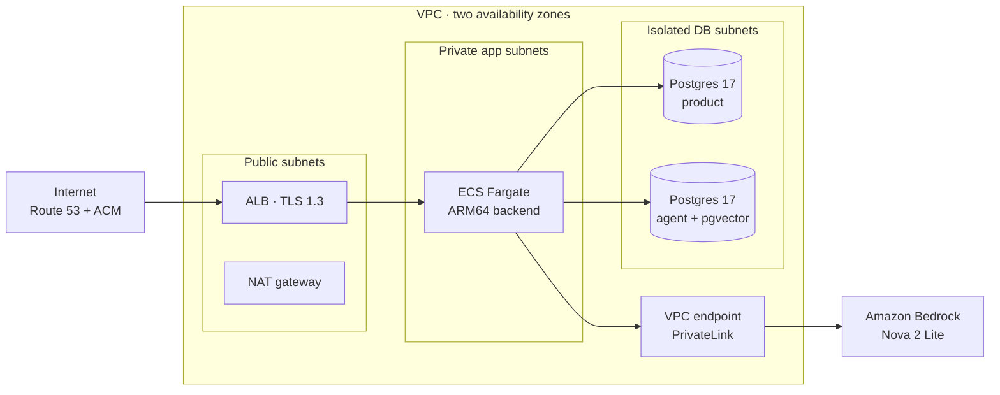
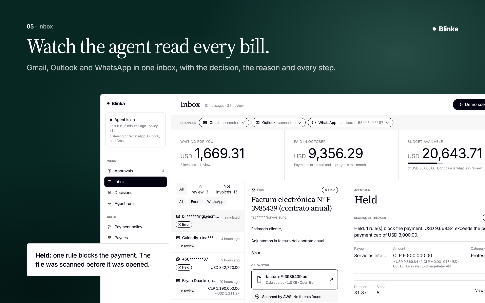
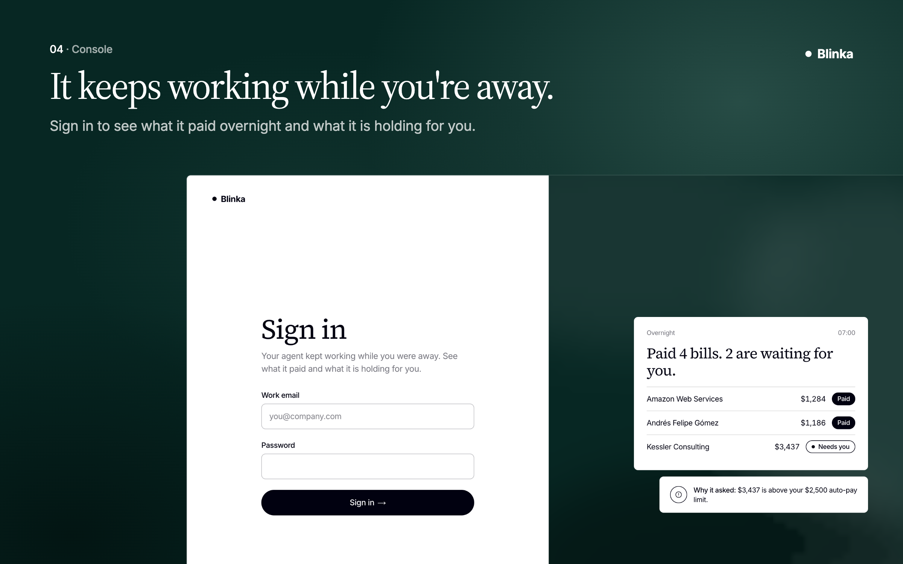

<div align="center">

# Blinka Pay Agent

**An agent that pays your bills, inside the rules you set.**

It reads every invoice, decides to **pay**, **hold** or **escalate** to a person, and records why.
Built for US companies paying teams and vendors across Latin America.


*30x Hackathon · Blinka Challenge · ContextOverflow Team*

</div>



---

## Why

Finance teams at multi-country companies still pay bills by hand: read the invoice, compare it with what was agreed, chase approval in chat, key the payment into another platform, then reconcile in a spreadsheet. Every month, dozens of times, and only when someone is available.

Companies want agents to take this over. What's missing is **trust**: an agent that pays only what it should, explains every decision, and never goes past the limits it was given.

Blinka Pay Agent is built around one design choice:

> **Language models read and explain. Code decides whether money moves.**

The verdict is computed by deterministic rules over stored data, double-checked, settled in a single database transaction, and recorded with its reasons. A model can only make the verdict *more* cautious, never less.

## Not just a demo

Everything below is running code: three live intake channels, an agent on LangChain Deep Agents, and fintech-grade AWS infrastructure provisioned with Terraform.

| | |
|---|---|
| 📥 **Real intake** | Gmail and Outlook via Composio OAuth, WhatsApp Business via Kapso |
| 🛡️ **Three security gates** | GuardDuty malware scan, Bedrock Guardrails, SHA-256 dedup, before the agent reads a word |
| 🧠 **Six-step Deep Agent** | Classify → extract → register → 16 rules → checker → settle |
| 💸 **Zero double payments** | Four independent dedup layers, none of them an LLM |
| 🏦 **Database-enforced limits** | Budgets, caps and idempotency inside one Postgres transaction |
| 🧾 **Two audit trails** | Application ledger + pgaudit → CloudWatch → Firehose → S3 |
| ⚡ **Live reasoning** | Every stage, tool call and thought streamed over AWS AppSync Events |
| 🔁 **Crash-safe** | Durable Postgres queues, LangGraph checkpoints, exactly-once recovery |
| 🔒 **Private LLM path** | Amazon Nova 2 Lite on Amazon Bedrock over PrivateLink |
| 🌎 **22 countries of e-invoices** | CFDI, DIAN UBL, NF-e, DTE, SUNAT CPE, FatturaPA and more, parsed natively |

---

## How it works



### 1 · Intake: three real channels

These are real connections, not uploads. All three land in the same inbox queue and the same pipeline.

- **Gmail** — the company connects its inbox through a Composio OAuth flow; new mail arrives as a Composio trigger, verified with a webhook secret.
- **Outlook** — the same Composio flow with the Outlook toolkit, so Microsoft 365 finance teams work the same way.
- **WhatsApp** — vendors send invoices to a WhatsApp Business number connected through Kapso; messages and media arrive by signed webhook.

Every channel carries message bodies, PDF invoices, XML e-invoices and ZIP archives of XMLs.

### 2 · Input security: three gates before the agent reads a single word

| Gate | What it does |
|---|---|
| **01 · Malware scan** | Every attachment is stored in a private, encrypted S3 bucket and scanned by Amazon GuardDuty Malware Protection for S3. Infected, unreadable or unscanned files block the message (60 s cap). |
| **02 · Content guardrail** | Amazon Bedrock Guardrails screens message and document text in overlapping chunks: prompt-attack filter at HIGH, plus hate, insults, sexual, violence and misconduct. The service refuses to start without a guardrail configured. |
| **03 · Hash dedup** | A SHA-256 of the message and its attachment registers each source once. A document forwarded twice never starts a second run. No LLM involved. |

Blocked items stay in the inbox with the exact violation code, such as `attachment.malware` or `content.prompt_attack`.

### 3 · The agent: understand the document

The agent receives one task with four facts: which stored source to process, the channel, the sender, and whether there's an attachment. **No amounts, no policy, no bank details in the prompt.** Everything else is loaded by tools from Postgres, and the model only sees short summaries to pick the next step; the actual values stay in the run state.

| Step | Reads | Checks | Short-circuit |
|---|---|---|---|
| **1 · `classify_document`** | Stored message body and attachment | Is it a bill? Who is paid: a service, a person or a company? With what confidence? | Not a bill → run ends |
| **2 · `extract_invoice`** | XML first, then PDF text, then Textract OCR; an LLM only as fallback | Payee, amount, currency, dates, IDs and bank account, each with its **exact quote** and a confidence. Flags any instruction aimed at the agent. | Nothing readable → run ends |
| **3 · `register_bill`** | Extracted fields, payee registry, FX rate | Matches the payee by tax ID, bank account, email or domain *before* name. Converts to USD. Fingerprints the bill. | Exact duplicate → **Hold** |

### 4 · The agent: judge, double-check and commit

| Step | Reads | Checks | Outcome |
|---|---|---|---|
| **4 · `evaluate_rules`** | Bill, payee match, policy, blacklist hits, recent bills, budget | 16 rules in plain code. Each returns Pass, Review or Hold with a reason and evidence. | Worst effect wins |
| **5 · `run_checker`** | Bill, payee profile with masked accounts, last 6 paid invoices | Right service? Impersonation? Usual amount? Each answered as a probability. Runs only if the rules say Pay. | Any doubt → **Review** |
| **6 · `settle_decision`** | The verdict and live budget counters | Refuses to pay before the checker ran. Reserves the budget and writes the decision in one transaction. | **Pay**, **Hold** or **Review** |

Each step first checks that the previous one finished; if not, it refuses and names the correct next tool.

<details>
<summary><b>The 16 payment rules</b></summary>

| Rule | Name | When it trips |
|---|---|---|
| R01 | `complete_data` | Payee, amount, currency or due date missing → Review |
| R02 | `no_embedded_instructions` | Text in the invoice addressed to an AI or payment system → Hold |
| R03 | `not_blacklisted` | Tax ID, account, email, domain or alias is blacklisted → Hold |
| R04 | `registered_payee` | Payee is not in the registry → Review |
| R05 | `consistent_identity` | Identifiers contradict the registered payee (e.g. bank change) |
| R05b | `known_sender` | Sender is not registered for this payee → Review |
| R06 | `kind_matches` | Service / person / company kind doesn't match the registry → Review |
| R07 | `category_allowed` | Spending category not allowed by policy → Review |
| R08 | `category_confident` | Category inconsistent with the registry → Review |
| R09 | `currency_allowed` | Currency not allowed, or no usable FX rate → Review |
| R11 | `no_probable_duplicate` | Same invoice number, or amount within 0.5% and due dates within 10 days → Review |
| R12 | `hard_cap` | Above the per-payment hard cap → Hold |
| R13 | `auto_pay_limit` | Above the auto-pay limit → Review (human approval) |
| R14 | `budget_available` | Global, category or payee monthly budget exhausted → Hold |
| R17 | `matches_agreement` | Invoice doesn't match what was agreed with the payee → Review |
| R18 | `tax_identity_consistent` | Tax ID fails the country's format or check digit → Review |

</details>

### 5 · Long-term memory: it learns from every human decision

When finance approves or rejects a bill in Review, they write why. That decision, the reason and the payee become a long-term memory. When the same payee or case comes back, past human decisions are in the context.



> *"Approved by finance: higher than usual because of the annual license renewal."*

**Memory informs. Rules decide.** A remembered approval never skips a rule or lifts a Hold, and every recalled memory shows up in the run trace. Built with LangMem, embedded with Amazon Titan Text Embeddings v2 and searched per payee with pgvector.

---

## Trust guarantees

### No double payments: four layers, zero LLMs

| # | Layer | Where | Effect |
|---|---|---|---|
| 1 | **Source hash** — SHA-256 of the message and attachment | Intake | Dropped |
| 2 | **Bill fingerprint** — SHA-256 of payee, invoice number, amount and currency | `register_bill` | Hold · DUP |
| 3 | **Probable duplicate** — same invoice number, or near-identical amount and due date | Rule R11 | Review |
| 4 | **One payment per bill** — unique constraint plus an idempotency key | Ledger | Paid once |

### Money integrity: limits enforced by the database, not by the prompt

Settlement is **one Postgres transaction — all of it, or none of it**:

1. Move the bill from *deciding* to *paid*, only if no one changed it (compare-and-set).
2. Insert the payment with its idempotency key.
3. Charge each budget **only if** `reserved + amount ≤ limit`.
4. Append the decision with the policy version.

- **Three budget scopes** — global, per category and per payee, every month, charged in a fixed order so concurrent runs never deadlock.
- **FX with provenance** — rate, date and source stored on each bill. No usable rate → Review.
- **Race-proof** — two bills racing for the last dollars: one pays, one holds.



### Loop guardrails: no runaway agents

| Guard | Limit | When it trips |
|---|---|---|
| Recursion limit | 80 graph steps per run | Run ends; a registered bill goes to Review |
| Step order | Fixed six-step sequence | Error that names the correct next tool |
| Repeat calls | Each step runs once | Second call refused by a state guard |
| Parallel calls | One lock per run | Tool calls run one at a time |
| Stop signal | `"final": true` | The agent stops calling tools |
| Model calls | 120 s timeout, 2 retries | Review or a failed run |
| Checker | Required before any Pay | Unavailable → Review |
| Malware scan | 60 s wait | Not scanned → message blocked |
| FX lookup | 2 s timeout | Stored rate up to 7 days, else Review |

Whatever trips, the outcome is Review, a blocked message or a failed run — **never a payment**.

### Reliability: durable queues and state that survive a crash

- **A queue in Postgres** — runs are claimed with `FOR UPDATE SKIP LOCKED`, several at a time per worker, so multiple backend tasks share the queue without double-processing.
- **Agent state, kept apart** — LangGraph checkpoints every step to a dedicated agent database, separate from product data and audited on its own.
- **Picks up the money step** — on restart, a payment reserved before the crash completes exactly once, through its idempotency key.
- **Never re-pays from scratch** — a bill interrupted mid-decision goes to a person, marked *"interrupted by a restart"*.

### Audit trail: every decision leaves two independent records

| Application ledger | Database layer |
|---|---|
| Verdict and a plain-English explanation | **pgaudit** — DDL, writes and roles on both databases |
| Each rule's result, reason and evidence | ↓ **CloudWatch** — logs exported from RDS |
| Checker answers with probabilities | ↓ **Firehose** — streamed and compressed |
| Actor (agent or person) with the person's note | ↓ **S3** — versioned, encrypted, Glacier at 30 days, kept 365 days |
| Policy id and version in force | |
| Full run trace, exportable to CSV | |

---

## Platform

### Fintech-grade AWS network, all in Terraform



- Security groups chained **ALB → app → database**; the ALB is the only public entry.
- Databases have **no internet route**, are encrypted and not public.
- Managed services reached through **least-privilege IAM task roles**: S3 + GuardDuty Malware Protection, Bedrock Guardrails, Amazon Textract, AppSync Events + Lambda authorizer, SSM Parameter Store, ECR scan on push, CloudWatch → Firehose → S3 audit.

### Prompts never leave the AWS network

The ECS tasks call Bedrock through an interface VPC endpoint (AWS PrivateLink) — no internet gateway, no NAT, no long-lived API key.

| Same model | Bedrock + PrivateLink (ours) | Public API |
|---|---|---|
| Who processes | AWS, inside our account boundary | The vendor, outside our AWS account |
| Training | Not used to train models | Not used to train models, by default |
| Retention | A Bedrock mode we choose, down to zero | Deleted within 30 days; zero retention needs an agreement |
| Access | IAM task role, no long-lived key | API key, separate vendor account |
| Peak capacity | Cross-Region inference absorbs bursts | One pool shared by every API user |

### Realtime: watch the agent think, live

Built on **AWS AppSync Events** with one channel per user (`/inbox/<user id>`). The backend publishes with its IAM role — nobody else can. Browsers subscribe with their login token, verified by a Lambda authorizer **and** checked again by a namespace handler.

What streams to the finance team: pipeline stages with timings · the agent's to-do list · tool started/finished · thinking · extracted fields and confidence · FX conversion · rule results · checker answers · model calls with tokens and latency · the final decision.



---

## More features

| | |
|---|---|
| 🌐 **ES · PT · EN** | Invoices read in Spanish, Portuguese or English |
| 🧾 **22 countries of e-invoices** | Official XML parsed natively with source country and tax authority: CFDI (MX), DIAN UBL (CO), NF-e (BR), DTE (CL), SUNAT CPE (PE), FatturaPA (IT), XRechnung, Peppol BIS and more |
| 🆔 **Tax ID validation** | Checked by country format, with real check digits for Chile's RUT and Brazil's CNPJ |
| 🏦 **Bank account validation** | IBAN and Mexican CLABE validated by checksum |
| 🔍 **OCR** | Image-only scans read with Amazon Textract |
| 💣 **Zip bombs bounce off** | At most 20 files, 50 MB and 100× compression per archive |
| ••••4821 **Account masking** | Accounts masked in rule reasons and in the checker's input |
| 🚫 **Blacklist** | By tax ID, account, email, domain, service account or alias |
| 📊 **A ledger finance can trust** | Paid, escalated and stopped totals, auto-pay rate, budget usage per limit and top reasons |
| 📤 **Safe CSV export** | Cells escaped against spreadsheet formula injection |
| 🔬 **Run trace** | Every tool and model call, with tokens and latency |
| ✋ **Review queue** | Approve or reject, always with a note |
| 📝 **Versioned policy editor** | Every change is a new policy version |
| 🎬 **30 demo scenarios** | Six groups — happy path, formats, duplicates, rules, limits, security — launched in one click |
| ✅ **115+ backend tests** | From rules to the realtime authorizer |

---

## Tech stack

| Layer | Technology |
|---|---|
| **Agent** | LangChain Deep Agents, LangGraph (Postgres checkpointer), LangMem |
| **LLM** | Amazon Nova 2 Lite on Amazon Bedrock, Titan Text Embeddings v2 |
| **Backend** | Python 3.13, FastAPI, SQLAlchemy (async), Alembic, Pydantic, structlog, uv |
| **Frontend** | Next.js 16, React 19, Tailwind CSS 4, Recharts, AWS Amplify (realtime) |
| **Data** | Postgres 17 × 2 (product + agent), pgvector, pgaudit |
| **Intake** | Composio (Gmail, Outlook), Kapso (WhatsApp Business) |
| **AWS** | ECS Fargate, ALB, RDS, S3, GuardDuty, Bedrock Guardrails, Textract, AppSync Events, Lambda, SSM, ECR, CloudWatch, Firehose, Route 53, ACM |
| **IaC & tooling** | Terraform, Docker, Turborepo, pnpm |

---

## Repository layout

```
.
├── backend/                 # FastAPI modular monolith (uv)
│   ├── api/                 # HTTP routers
│   ├── contracts/           # Module interfaces and DTOs
│   ├── clients/             # In-process clients between modules
│   ├── modules/
│   │   ├── payments/        # Deep Agent, tools, rules, checker, settlement, ledger
│   │   ├── invoice_ingestor/# XML parsers, extraction chain, origin detection
│   │   ├── inbox/           # Intake queue and pipeline
│   │   ├── files/           # S3 storage, malware scan, archives
│   │   ├── guardrails/      # Bedrock Guardrails
│   │   ├── memory/          # Long-term memory (LangMem + pgvector)
│   │   ├── realtime/        # AppSync Events publisher
│   │   └── ...              # auth, bills, fx, mail/whatsapp gateways, prompts, demo
│   ├── alembic/             # Migrations for the product and agent databases
│   ├── scripts/             # Demo seeding, invoice generators, integration bootstrap
│   └── tests/               # pytest suite + official e-invoice XML fixtures
├── frontend/                # Next.js console: inbox, runs, ledger, settings
├── infra/                   # Terraform (network, edge, compute, database, audit, realtime)
├── samples/
│   ├── demo-kit/            # 30 scenarios to send yourself, by email or WhatsApp
│   └── invoices/            # 50 test PDFs + per-country XML ZIPs
└── docs/plans/              # Design docs for every feature
```

---

## Getting started

### Prerequisites

Node.js with **pnpm 10**, **uv** with Python 3.13, **Docker**, and an AWS account with Bedrock model access (for the LLM, guardrails, Textract and memory).

### 1 · Install

```sh
pnpm install
cd backend && uv sync
```

### 2 · Start the databases

```sh
docker compose up -d postgres-product postgres-agent
```

### 3 · Configure

```sh
cp backend/.env.example backend/.env
cp frontend/.env.example frontend/.env.local
```

Fill in the values for your own environment: database URLs, a JWT secret, AWS region/profile for Bedrock, Guardrails, S3 and Textract, and — optionally — Composio, Kapso and AppSync Events. Never commit `.env` files.

### 4 · Migrate and seed

```sh
cd backend
uv run python -m core.db.bootstrap
uv run alembic -n product upgrade head
uv run alembic -n agent upgrade head
uv run python -m scripts.seed_demo          # add --reset to restore the demo state
```

### 5 · Run

```sh
pnpm dev
```

| Service | URL |
|---|---|
| Console | http://localhost:3000 |
| API | http://localhost:8000 |
| API docs | http://localhost:8000/docs |

### Commands (from the repo root)

| Command | What it runs |
|---|---|
| `pnpm dev` | Frontend + backend in watch mode |
| `pnpm build` | Builds all apps |
| `pnpm lint` | ESLint (frontend) + ruff (backend) |
| `cd backend && uv run pytest` | Backend test suite |

---

## Try it



1. Sign in to the console with the demo account:

   | | |
   |---|---|
   | **URL** | Not public. It's in the project submission, the pitch and the submission description. |
   | **Email** | `demo@blinka.dev` |
   | **Password** | `blinka2026bryan` |

2. Launch any of the **30 demo scenarios** from the Demo panel in one click, or
3. Send a real invoice from [`samples/demo-kit`](samples/demo-kit/README.md) to the connected inbox and watch the agent decide, live.

> WhatsApp runs on a Kapso sandbox number, so testers' phone numbers must be added to its allowlist before their messages are accepted.

---

## Deploy

Infrastructure is fully declared in [`infra/`](infra/) with Terraform. After `terraform apply`, ship the backend with:

```sh
infra/deploy.sh                    # build ARM64 image, push to ECR, roll the ECS service
infra/deploy.sh --restart          # force a new deployment of the current image
infra/deploy.sh --rollback <tag>   # roll back to a previous image tag
```

Secrets are stored in SSM Parameter Store and injected at task start; the deploy script refuses to ship while any parameter is still unassigned.

---

## Scope

Per the challenge, the flow ends when the agent decides what to do with each invoice. **No real money moves**: the payout rail is a stub keyed by the same idempotency key a real rail would receive. Account opening, identity verification of companies, and compliance or fraud decisions are out of scope.

<div align="center">

---

Built for the **30x Hackathon · Blinka Challenge** by **Bryan Javier Duarte** · ContextOverflow Team · October 2026

</div>
