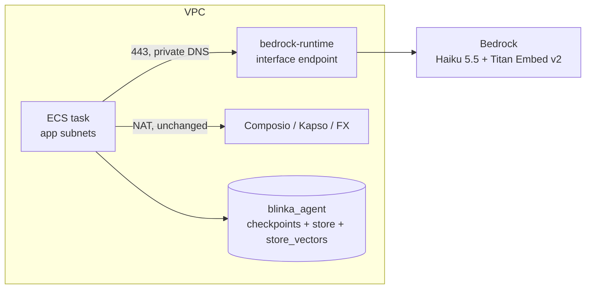
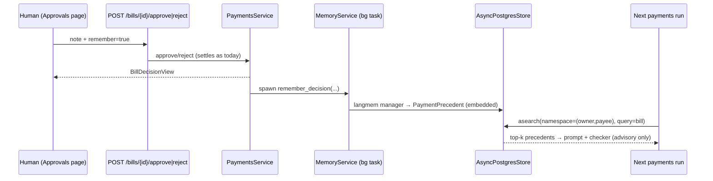

# Bedrock (private), agent memory from approvals, agent run limits

> "We taught the payments agent to remember what the CFO said and to stop after three minutes. That already puts it ahead of most finance meetings."
> - El Barto

## Overview

**Request**: Move LLM calls from OpenRouter to AWS Bedrock and reach Bedrock through a VPC interface endpoint, so the traffic never crosses the public internet. Let a human's approve/reject note become a long-term memory for the agent, opted in with a "Remember this" checkbox. Store it in the agent database in langmem's standard format, not as raw text. Add a time limit and a tool-execution limit to the payments agent so a loop can't run forever.

**Created**: 2026-10-18

## What

1. **Bedrock instead of OpenRouter**
   - `ChatBedrockConverse` (langchain-aws) replaces `ChatAnthropic`, which currently points at OpenRouter.
   - One model for everything: Claude Haiku 5.5, `global.anthropic.claude-haiku-5-5`.
   - OpenRouter is removed completely: settings, SSM parameter and dependency.
   - `aioboto3` is replaced with `aiobotocore` 3.x. This unblocks a current `langchain-aws`, which brings Bedrock prompt caching.
2. **Private network path**
   - A `bedrock-runtime` interface VPC endpoint with private DNS in the app subnets, plus an endpoint security group.
   - Task-role IAM gets `InvokeModel` / `InvokeModelWithResponseStream` for Haiku 5.5 and Titan Embed v2.
3. **Agent run limits**
   - Limits: 180 s wall clock, 30 tool calls, 35 model calls, set through `BLINKA_AGENT__*`.
   - Enforced with langchain `ToolCallLimitMiddleware` and `ModelCallLimitMiddleware`, plus `asyncio.timeout`.
   - When a limit is hit, the bill escalates to a human (REVIEW). A new `limit_exceeded` node appears in the run timeline.
4. **Long-term memory from human notes**
   - A "Remember this" checkbox next to the approve/reject note.
   - A langmem `create_memory_store_manager` runs in a background task. It turns the note and its decision context into structured `PaymentPrecedent` memories.
   - Memories live in LangGraph `AsyncPostgresStore` in `blinka_agent`, with a pgvector index built from Titan Embed v2 embeddings. The namespace is `("payments_memories", owner_id, payee_key)`.
   - Later runs for the same payee get the relevant memories as advisory context, in both the agent prompt and the LLM checker. Memories can **never** waive hard rules.
   - A `/settings/memories` page lists memories and lets you delete them. A demo reset wipes them.

## Why

- **Privacy and compliance:** invoices, bank details and approval notes currently go to a third-party gateway over the internet. Bedrock behind a VPC endpoint keeps them inside AWS.
- **Trust:** the agent should learn from the decisions people make ("this vendor bills quarterly, the bump is expected") without anyone repeating themselves. That learning stays visible, can be deleted, and is never allowed to override the rules.
- **Safety:** today the only brake is `recursion_limit=80`. A model stuck in a loop can burn tokens for minutes. The new limits make the worst case bounded and explainable.

## Impact

- **Backend:**
  - Changed: `llm_gateway`, `payments` (agent, runner, checker, service), `prompts`, `core/config.py`, `core/db/checkpointers.py`, `container.py`, the four AWS adapters, `demo` reset.
  - New: a `memory` module.
- **Frontend:** `ReviewActions` (checkbox), a new settings tab and page, a `limit_exceeded` timeline node.
- **Infra:**
  - `network.tf`: endpoint and security group.
  - `compute.tf`: IAM.
  - `ssm.tf`: model and memory params; OpenRouter key removed.
  - `docker-compose.yml`: switches to the pgvector image.
- **Data:** new LangGraph store tables (`store`, `store_vectors`, migrations) in `blinka_agent`. No changes to the product DB schema.

## Flow

