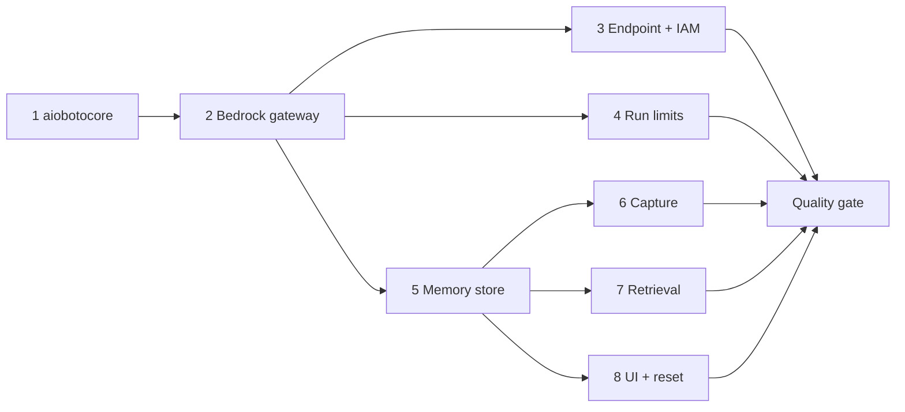

# Implementation Tasks

## Task Breakdown

### 1. AWS SDK swap (aiobotocore)
- [x] `uv remove aioboto3`, then `uv add aiobotocore`
- [x] Port `modules/document_vision/textract.py` to `AioSession(profile=...).create_client("textract", region_name=...)`
- [x] Port `modules/guardrails/bedrock.py` (`bedrock-runtime`)
- [x] Port `modules/files/storage.py` (S3, keep the `Config(s3=...)`)
- [x] Port `modules/realtime/appsync.py` credential lookup (`AioSession.get_credentials()`)

### 2. Bedrock LLM gateway
- [x] `uv add langchain-aws langmem` and confirm `langchain-aws>=1.4` in `uv.lock`
- [x] Rewrite `LlmSettings`: drop the OpenRouter fields, add AWS profile/region/connect timeout, set the Haiku 5.5 default
- [x] `_build_chat_model` → `ChatBedrockConverse` with a botocore `Config` (timeouts, adaptive retries)
- [x] Sanitize the PDF `filename` into a valid Converse document name
- [x] Register the payments harness profile for `"amazon_bedrock"` as well as `"anthropic"`
- [x] Make sure `core/agents.message_text` skips Haiku 5.5 reasoning blocks and keeps only text blocks
- [x] Update `.env.example` (remove OpenRouter, add `BLINKA_LLM__AWS_PROFILE`, `BLINKA_AGENT__*`, `BLINKA_MEMORY__*`)
- [x] `uv remove langchain-anthropic` if nothing imports it directly
- [ ] Verify the model ID: `aws bedrock list-inference-profiles --region us-east-1 | grep haiku-5-5` and confirm model access is granted

### 3. Private network + IAM (Terraform)
- [x] `aws_security_group.vpce` with ingress 443 from `aws_security_group.app`
- [x] `aws_vpc_endpoint.bedrock_runtime` (Interface, private DNS, app subnets)
- [x] `backend_bedrock_invoke` IAM policy (Haiku 5.5 profile + foundation models, Titan v2) on the task role and the local-dev IAM user
- [x] `ssm.tf`: remove `OPENROUTER_API_KEY`; move `BLINKA_LLM__MODEL` to managed with the Bedrock ID; drop the `MAIN_MODEL`/`PAYMENTS_MODEL` params; add `BLINKA_LLM__AWS_REGION`, `BLINKA_MEMORY__AWS_REGION`
- [ ] `terraform plan` shows only the expected adds/changes; apply; `deploy.sh --restart`

### 4. Agent run limits
- [x] `AgentSettings` + `modules/payments/limits.py` (`AgentLimit`, `AgentRunLimits`, `AgentLimitHit`) + `AgentLimitExceededError`
- [x] Add `limits` to `PaymentRunDependencies` and wire it in `container.py`
- [x] `build_payments_agent(..., limits)` adds `ToolCallLimitMiddleware` and `ModelCallLimitMiddleware` (`exit_behavior="error"`)
- [x] `runner._run_agent`: wrap in `asyncio.timeout`; map `TimeoutError`, `ToolCallLimitExceededError` and `ModelCallLimitExceededError` to `state.limit_exceeded`; emit the `limit_exceeded` step
- [x] `runner._finalize`: on a limit hit, call `fail_closed(..., explanation=...)`, or raise `AgentIncompleteError(limit reason)` when there's no claim
- [x] Add a `STEP_PHRASES` entry for `limit_exceeded`
- [x] Frontend: `runEvents.ts` constant and extractor, `RunTimeline` "Stopped: limit" node, types

### 5. Agent memory store
- [x] `docker-compose.yml`: `postgres-agent` → `pgvector/pgvector:pg17` (also the local dev containers on 55434)
- [x] `core/db/bootstrap.py`: `CREATE EXTENSION IF NOT EXISTS vector` on the agent DB
- [x] `MemorySettings` in `core/config.py`
- [x] `core/db/checkpointers.py`: build `AsyncPostgresStore(pool, index=...)` and `setup()` when memory is enabled; expose `.store`
- [x] `alembic/env.py`: exclude the LangGraph store tables from autogenerate
- [x] New `modules/memory/` (`schemas.py`, `errors.py`, `service.py`, `__init__.py`), `clients/memory.py`, `contracts/memory.py`
- [x] `MemoryService`: `remember_decision`, `remember_decision_later`, `recall`, `list_for_owner`, `forget`, `forget_owner`
- [x] Wire `MemoryClient` in `container.py`

### 6. Memory capture (approve/reject)
- [x] `ReviewActionRequest.remember: bool = False`
- [x] `PaymentsService.approve`/`reject`: build `DecisionMemoryInput` and call `memory.remember_decision_later` when `remember` is set (approve only on a successful settle)
- [x] Frontend: "Remember this" checkbox in `ReviewActions.tsx`; `api.approveBill/rejectBill(billId, note, remember)`

### 7. Memory retrieval (advisory)
- [x] `RunState.precedents`; `DecisionContext.precedents`
- [x] `_register_bill`: call `recall` after the claim and add precedents to the tool output
- [x] Pass precedents into the checker context; add a `<human_precedents>` block to `_checker_content`
- [x] Payments agent prompt and checker prompt: add the advisory-only paragraph
- [x] Optional emit: a `precedents_recalled` step (count) so the trace shows memory was used

### 8. Memory management UI + demo reset
- [x] `api/routers/memory.py`: `GET /memories`, `DELETE /memories/{payee_key}/{memory_id}`; map `MemoryNotFoundError` → 404
- [x] `DemoService.reset` → `memory.forget_owner`
- [x] Frontend: `/settings/memories` page + tab, `api.memories()`, `api.deleteMemory()`, `MemoryView` type

### Post-Implementation Quality Gate
- [x] Run a two-subagent quality pass over the recently-applied change:
  - [x] **Bug sweep:** launch a subagent to search the modified code for bugs, issues and inconsistencies (logic errors, edge cases, broken contracts, dead code, regressions). Report concrete findings as `file:line` references.
  - [x] **Polish:** launch a subagent that improves code quality by invoking the `codebase-change` skill and applying the polish DIRECTLY to the changed files: delete unnecessary comments, make the code self-explanatory, give every variable an obvious purpose, maximize readability and maintainability, and remove unnecessary complexity. Resolve any real issues the bug sweep surfaced.

## Task Order

Tasks 4 and 5 are independent of each other, and so are 6, 7 and 8 once 5 is done.

## Implementation Notes (deviations)

- **Wall clock 300 s, not 180 s.** Measured 79 completed dev runs: p95 73 s, max 85 s, max 13 tool calls, max 14 agent model calls. 180 s left ~2x headroom over the slowest run; Bedrock retries or slow PDF extraction could escalate healthy invoices. Tool (30) and model (35) caps stay, each ~2.3x a clean run.
- **Recursion backstop is derived, not 80.** The two limit middlewares add graph nodes (~6 steps per model call; a clean 14-call run needs 86 steps), so 80 would break normal runs. `agent_recursion_limit(limits) = max_model_calls * 8`, and a test proves an endless loop hits the middleware first. `GraphRecursionError` maps to the model-call limit.
- **`TimeoutError` maps to the time limit only when our deadline expired** (`asyncio.Timeout.expired()`); any other `TimeoutError` stays a technical error.
- **No `bootstrap.py` pgvector step.** `AsyncPostgresStore.setup()` already creates the `vector` extension idempotently.
- **`PaymentsService` has no new `memory` kwarg.** Memory reaches it through `PaymentRunDependencies.memory`, which it already holds.
- **`DELETE /memories/{payee_key}/...` rejects keys with `.`** (LangGraph namespace separator) as 404 instead of a 500.
- **Haiku 5.5 access is not enabled for the account** (`AccessDeniedException`), and Anthropic use-case details are not submitted (Haiku 4.5 returns `ResourceNotFoundException`). Titan embeddings work (1024 dims). End-to-end LLM verification is pending on that.
- **Quality gate fixes (bug sweep):** precedents now carry `decided_at` and the checker gets `<today>` so `applies_when` can be judged; the checker prompt forbids precedents from lowering the CHK2 impersonation concern; approve reads the escalation before claiming the bill; `_finalize` skips `fail_closed` when this run already committed a decision (timeout mid-settle); a limit hit after settlement is logged, not shown as a stop; demo reset wipes memories after the final cancel and fails loudly; botocore retries use `total_max_attempts`; the default thread pool is sized by `BLINKA_WORKERS__BLOCKING_IO_THREADS` (64) because `ChatBedrockConverse`/`BedrockEmbeddings` run in executor threads.
- **Not changed (accepted):** langmem writes then the service re-puts with `source` (two embeddings per memory); name-keyed memories are not migrated when a payee is later registered; `/memories` lists at most 200 items.
- **Open operator steps:** enable Bedrock access to Claude Haiku 5.5 (and submit the Anthropic use-case form), then `terraform apply` + `deploy.sh --restart`, then the ECS Exec smoke test.
- **Live run on Nova 2 Lite (2026-10-18):** a real end-to-end flow on Bedrock surfaced two fixes. Memory capture now uses langmem's stateless `create_memory_manager` plus one store write that carries `source` (the store manager wrote first and our provenance re-put landed 31 s later, leaving memories without a source in the UI). AWS clients are now created on first use, because aiobotocore's `create_client()` starts a coroutine that leaked as "never awaited" for unused adapters.
- **Pre-existing, not from this plan:** `GET /payments/runs/{id}/trace` returns only the system prompt. LangGraph checkpoints on this version store no `messages` blob, in old runs too.
