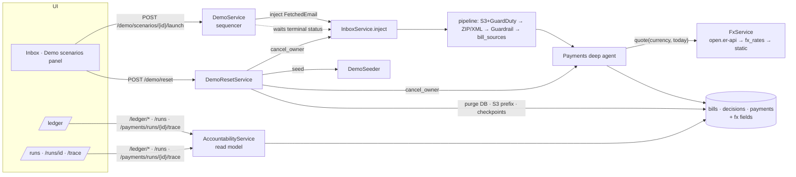

# Demo Scenarios, Agent Ledger & USD Conversion

> "Nothing builds trust in an autonomous payments agent like a big red 'reset everything' button."
> - El Barto

## Overview

**Request**: Make the demo easy to show. Seed a demo user with rules, contacts (persons, companies, services), blacklist and months of payment history. Trigger many scripted scenarios from the UI (happy path, duplicates, prompt injection, data in the email body, PDF, ZIP, standalone XML, mismatched agreement, limits, budget, malware) and reset the demo user to its initial state. Add the agent's accountability ledger with charts, a full execution view, and convert every amount to USD while keeping the original currency.

**Created**: 2026-10-17

## What

1. **Demo account**: a fixed `demo@blinka.dev` account. When `BLINKA_DEMO__ENABLED=true` it is created on startup. It represents a fictional US company with a LatAm team: policy, 11 payees (persons, companies, services), blacklist, a trusted finance forwarder, and about 3 months of paid history plus the current month. The current month already has one payee at its limit and the cloud category near its cap. The login page gets an "Enter the demo" button.
2. **Scenario launcher**: a slide-over panel in the inbox with about 30 scenarios in 6 sections. Multi-step scenarios run as scripted sequences, and each step waits for the previous run to finish. All of them go through the real pipeline: S3, GuardDuty, ZIP/XML, Bedrock guardrail, agent and Textract. Attachments are styled PDFs (fpdf2).
3. **Self-send kit**: reviewers download the same PDF, ZIP and XML files (plus suggested email bodies) per scenario or as a full kit, and send them from their own email or WhatsApp to the demo's real channels. A "trusted forwarders" list keeps a forwarded invoice from being escalated only because the sender is unknown. `scripts/export_demo_kit.py` writes the same kit to `samples/demo-kit/`.
4. **Reset demo**: cancels in-flight runs, then wipes everything the demo user owns except mailbox connections (DB rows, S3 objects, LangGraph checkpoints), then re-seeds.
5. **Agent ledger** (`/ledger`): every agent outcome (paid, escalated, held, blocked, duplicate, not an invoice) with its reasons. It has KPI tiles, Recharts charts, tabs, filters and CSV export.
6. **Executions**: `/runs` lists every run. `/runs/[id]` is the business summary and `/runs/[id]/trace` shows the full LLM trace from the LangGraph checkpoint.
7. **USD conversion**: rates come from open.er-api.com and are cached daily in `fx_rates`, falling back to the last stored rate and then a static table. Every bill and payment stores its original amount and currency, the USD amount, the rate, the rate date and the source.
8. **English everywhere**: the console UI, rule reasons, agent phrases and explanations. Simulated documents stay in each vendor's local language.
9. **Secure-by-default guardrail**: `enforce=True` by default, startup fails fast if no guardrail ID is set, and the `.env` typo is fixed.

## Why

The brief asks for an agent that pays only what it should, explains every decision and never breaks its limits. The current demo can't show that well:

- The account has to be seeded by hand.
- There's no history, so per-payee and budget limits can't trigger on one click.
- Scenarios sit in a flat dropdown.
- Duplicates and budget cases depend on clicking in the right order.
- Re-running a demo leaves the state polluted.
- There's no single view where a finance lead can audit every decision.
- FX is a hard-coded dummy table, with no record of which rate was used.

## Impact

- **Backend**: three new modules (`fx`, `demo`, `accountability`), one product-DB migration (`fx_rates`, FX columns, `trusted_forwarders`), FX wired into the payments agent, the English copy rewrite, `ExecutionRegistry` per-owner cancel, and S3 prefix delete. The old `/inbox/simulate` and `samples.py` are replaced by the demo catalog.
- **Frontend**: the whole console moves to English and the en-US locale. Recharts is added as a new dependency. New pages: `/ledger`, `/runs`, `/runs/[id]`, `/runs/[id]/trace`. The inbox gets the slide-over panel and the login page gets the demo button.
- **Infra**: none. Outbound HTTPS to open.er-api.com is already possible.

## Flow

