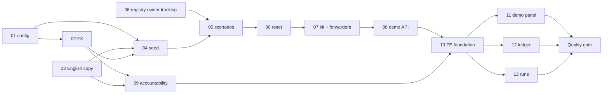

# Implementation Tasks

## Task Breakdown

### 01 · Config & guardrail
- [x] Set `GuardrailsSettings.enforce` to default `True`, keeping the fail-fast validator
- [x] Add `FxSettings` and `DemoSettings` (with password validator and `inbox_address`), exposed on `Settings`
- [x] Fix the `backend/.env` key `BLINKA_GUARDRAILS__ENFORCE`, drop the dead key, and add the `BLINKA_DEMO__*` / `BLINKA_FX__*` keys
- [x] Document the new keys and the secure default in `.env.example`
- [x] Update test settings that relied on `enforce=False`

### 02 · FX conversion
- [x] Add `contracts/fx.py` (`FxSource`, `FxQuote.convert`)
- [x] Create the `modules/fx` module: models, repository, provider (open.er-api.com), static rates, service, errors, client
- [x] Add a migration for `fx_rates`, the FX columns on `bills` and `payments`, and `trusted_forwarders`
- [x] Quote in `_register_bill`, persist on the bill, and copy to `ReservationRequest` and then to `payments`
- [x] Make `context_builder` use `bill.amount_usd`, and remove `to_usd` and `DUMMY_USD_PER_UNIT`
- [x] Expose the FX fields in `BillDecisionView` and `PaymentView`, plus the explain-line FX format
- [x] Wire `FxClient` in `container.py` and `PaymentRunDependencies`

### 03 · Backend English copy
- [x] Translate the phrases, rule reasons, `RULE_NAMES`, explain, budget scopes, settlement reasons, checker questions and tool hints
- [x] Update the prompts so todos, summaries and rationales are in English while documents in any language are still read
- [x] Sweep the inbox, guardrail and files user-facing strings

### 04 · Demo seed
- [x] Add `fpdf2` to the backend
- [x] Write `seed_data.py`: policy, 11 payees, blacklist, FX by month, `history(today)`
- [x] Write `documents.py`: styled invoice PDF, scanned image-only PDF, CFDI and DTE XML renderers
- [x] Write `DemoSeedRepository.insert_history` (bills, decisions, payments, counters, backdated)
- [x] Write `DemoSeeder.seed`, including the default trusted forwarder
- [x] Add `scripts/seed_demo.py` and delete `scripts/seed_payment_policy.py`

### 05 · Demo scenarios & sequencer
- [x] Write `catalog.py` with the 30 scenarios across 6 sections and builders using `LaunchContext`
- [x] Add `InboxService.inject`, `get_email_status` and `cancel_owner`, and remove `simulate`, `samples.py` and `SimulatedEmailKind`
- [x] Write the `run_sequence` sequencer, which waits for each step to reach a terminal status
- [x] Add `DemoService.catalog`, `launch` and `get_launch`
- [x] Validate expectations: reset, run every scenario once, and fix scenario data until the outcomes match

### 06 · Demo reset
- [x] Add owner tracking and `cancel_owner` to `ExecutionRegistry`, and pass `owner_id` on every spawn
- [x] Add `DemoResetRepository.purge_owner` (FK-ordered, one transaction, keeps connections and forwarders)
- [x] Add `StorageBackend.delete_prefix` and `FilesService.purge_owner_objects`
- [x] Add `PaymentsService.purge_run_threads` (checkpoints)
- [x] Implement `DemoService.reset`: lock, cancel, purge, re-seed, realtime refresh

### 07 · Self-send kit & trusted forwarders
- [x] Add the `trusted_forwarders` model, contracts, repository, service, client and routes
- [x] Make `match_payee` drop sender identifiers for trusted senders, and add the R05b PASS reason
- [x] Write `kit.py`: deterministic files, per-scenario and full ZIP, README with destinations and expectations
- [x] Add `scripts/export_demo_kit.py` and export to `samples/demo-kit/` (no EICAR)

### 08 · Demo API & bootstrap
- [x] Add `AuthService.ensure_user`
- [x] Add the public routers `/demo/status` and `/demo/login`, plus the demo-only routes for the catalog, launch, launches, reset and kit
- [x] Add `DemoUserDep`, the error mappings, and the `lifespan` ensure and shutdown
- [x] Wire `DemoClient` and `AccountabilityClient` in the container

### 09 · Accountability backend
- [x] Add the `contracts/accountability.py` read models
- [x] Write the ledger entries `UNION` query (decisions plus inbox-only outcomes) and the outcome mapping
- [x] Write the summary: KPIs, weekly timeline, limits (reusing `budget_usage`), top reasons, currencies
- [x] Write the CSV export with formula-injection escaping
- [x] Add the `/runs` list query
- [x] Add the `GET /payments/runs/{id}/trace` checkpoint serializer

### 10 · Frontend foundation
- [x] Translate the whole console to English, with `lang="en"` and `en-US` formatting
- [x] Update the nav: Agent ledger, Executions
- [x] Mirror all new types, add the API calls and `downloadBlob`, and remove the simulate code
- [x] Add the `MoneyWithUsd` component and use it in `DecisionCard` and `EmailDetail`
- [x] Add the "Enter the demo" button on login
- [x] Add `recharts`

### 11 · Demo panel
- [x] Add the slide-over panel with sections, rows, expectations, channel badges and Send
- [x] Add `useDemoLaunches` polling and step progress chips
- [x] Add the self-send card: destinations, full kit download, trusted forwarders editor
- [x] Add the reset confirm dialog and refresh flow
- [x] Show the guardrail and malware-scan notices

### 12 · Agent ledger page
- [x] Add the `/ledger` page with URL-synced filters and tabs
- [x] Add the KPI strip
- [x] Add the charts: decisions over time, limits per payee, top reasons, currency breakdown
- [x] Add the ledger table with expandable rows and execution links
- [x] Add the CSV export and FX attribution footer

### 13 · Executions pages
- [x] Add the `/runs` list with status filter and polling
- [x] Add the `/runs/[id]` summary: header, timeline (extract `lib/runEvents.ts`), decision, FX, evidence
- [x] Add the `/runs/[id]/trace` technical page: message cards, JSON blocks, mini-index, copy
- [x] Add links from `EmailDetail` and `AgentActivity`

### Post-Implementation Quality Gate
- [x] Run a two-subagent quality pass over the recently-applied change:
  - [x] **Bug sweep**: launch a subagent to search the modified code for possible bugs, issues, and inconsistencies (logic errors, edge cases, broken contracts, dead code, regressions). Report concrete findings as `file:line` references.
  - [x] **Polish**: launch a subagent that invokes the `codebase-change` skill and applies the polish directly to the changed files. It deletes unnecessary comments, makes the code self-explanatory, gives every variable an obvious purpose, maximizes readability and maintainability, and removes unnecessary complexity. It also resolves any real issues the bug sweep surfaced.

## Task Order

