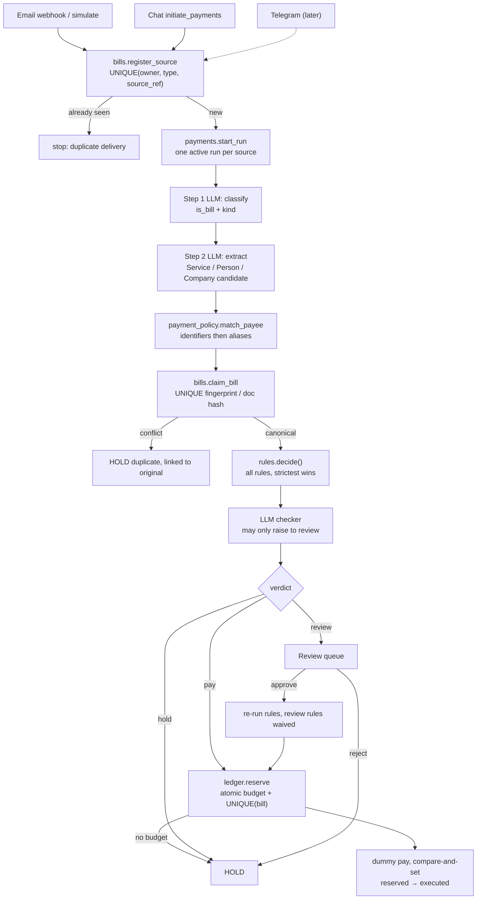

# Payment rules, payee registry, dedup and human review

> "We taught the agent to pay bills. Now we teach it the harder skill: saying no to AWS when AWS asks to be paid into Kevin's checking account."
> - El Barto

## Overview

**Request**: Add configurable payment rules (global hard cap, auto-pay max, monthly budget, per-category budgets, allowed services, blacklist, trusted companies and people) and a registry of payees. Every bill that arrives by email (body and PDF), chat or, later, Telegram is classified as a service, person or company, extracted into a typed `PaymentCandidate`, matched against the registry and checked against the rules. The agent then pays, holds or sends the bill to human review, and explains why. The design guarantees no duplicate payments across sources, retries or races.

**Created**: 2026-10-17

## What

- **Payment policy (`payment_policy` module).** Each owner has versioned rules: hard cap per payment, auto-pay max, monthly budget, monthly budget per category, allowed categories, allowed currencies, and dedup and confidence thresholds. The module also holds the payee registry (services, people, companies with their identifiers and per-payee limits) and the blacklist. CRUD endpoints plus a demo seed script.
- **Bills (`bills` module).** Each delivery is recorded as a *bill source* (email, chat, upload, telegram). Each canonical bill is recorded once. Duplicates are caught in three layers: the same delivered message, the same document hash, and the same bill fingerprint.
- **Two-step extraction (`invoice_ingestor`).** First the LLM classifies the bill (is it a bill? is it a service, person or company?). Then it extracts with the schema for that kind, reading the email body and the PDF together, with evidence and confidence for each field. The currency is never inferred.
- **Decision engine (`payments`).** A pure rules function returns pay, hold or review, and the result for every rule. An LLM checker then asks typed questions and returns probabilities; it can only raise a verdict to review, never approve.
- **Ledger.** One payment per bill, enforced by the database. Budget is reserved atomically per scope and period. The dummy pay runs in code exactly once. The LLM never has a pay tool.
- **Human review.** Approve and reject endpoints re-run the rules and reserve budget atomically. The inbox UI shows the decision card, each rule's result and the Approve/Reject buttons. New screens edit the policy, payees and blacklist.

## Why

- `CLAUDE.md` defines the whole job: decide pay, hold or escalate within configurable rules, log every decision with its reason, and handle the trap cases (duplicate charge, new payee, bill that doesn't match the agreement, over the limit, budget exhausted).
- Today none of that exists. A deep agent analyzes CLP. There is no payee registry, no rules and no locking. The only dedup is the email message id. The same bill sent twice, or sent by email and chat, produces two runs.
- An `execute_payment` tool for the LLM still exists in the code. Every serious competing team keeps payment out of the model's reach.

## Impact

- New module: `payment_policy`, which owns the rules, the registry, the blacklist and payee matching.
- New module: `bills`, which owns bill sources, canonical bills and dedup keys.
- `invoice_ingestor`: `parse()`, `InvoiceData` and the `invoices` table are replaced by `extract_candidate()`.
- `payments`: the deep agent and `execute_payment` are removed. It gains the rules engine, the checker, the ledger, budget counters, review actions and a startup sweep.
- `inbox` and `orchestrator`: they register bill sources before starting a run, and the email body and PDF are both sent to extraction.
- Product DB: 8 new tables and one dropped table, created by Alembic autogenerate.
- Frontend: a decision and review card in the inbox, plus `/settings/policy`, `/settings/payees` and `/settings/blacklist`.

## Flow

