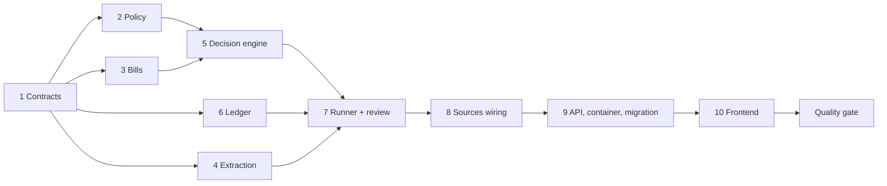

# Implementation Tasks

## Task Breakdown

### 1. Contracts (`06-implementation/01-contracts`)
- [x] Create `contracts/payment_policy.py`: enums, policy, payee, identifier and blacklist contracts, and the match result
- [x] Create `contracts/payment_candidates.py`: base schema plus Service, Person and Company subtypes, `BillClassification`
- [x] Create `contracts/bills.py`: `BillSourceType`, `BillStatus`, source intake and records, claim result
- [x] Rewrite `contracts/payments.py`: verdicts, rule results, checker, decision views, ledger views, new trigger and run status; delete the CLP analysis
- [x] Update `contracts/inbox.py`: new statuses, `decision` replaces `analysis`
- [x] Delete `contracts/invoices.py`; add the new `PromptId` members

### 2. Payment policy module (`02-payment-policy`)
- [x] Models: `payment_policies`, `payees`, `payee_identifiers`, `blacklist_entries`
- [x] `normalize.py`: name, identifier, email and domain normalization; `strong_identifiers()`
- [x] Repository: versioned policy activation, payee CRUD with optimistic lock, identifier ownership, blacklist
- [x] `matching.py`: payee matching from identifiers first, then aliases, plus the blacklist lookup
- [x] Service, errors and facade; `clients/payment_policy.py`
- [x] Seed script `scripts/seed_payment_policy.py` with the demo company, payees and blacklist

### 3. Bills intake and dedup (`03-bills-intake-dedup`)
- [x] Models: `bill_sources`, `bills` with partial unique indexes
- [x] Repository: `register_source` (ON CONFLICT), `claim_bill` (canonical-or-duplicate in one transaction), compare-and-set status updates, recent-bills lookup
- [x] Fingerprint and hash helpers
- [x] Service, errors and facade; `clients/bills.py`

### 4. Candidate extraction (`04-candidate-extraction`)
- [x] Prompts: classification plus 3 per-kind extraction prompts, registered
- [x] `InvoiceIngestorService.classify()` and `.extract_candidate()` reading body text and the PDF together
- [x] Remove `parse()`, `InvoicesRepository`, the `invoices` model and the old extraction prompt

### 5. Decision engine (`05-decision-engine`)
- [x] `modules/payments/fx.py` (dummy USD rates)
- [x] `modules/payments/rules.py`: `decide()` with R01–R17 and Spanish reason templates
- [x] `modules/payments/checker.py`: `PAYMENT_CHECKER` prompt plus `apply_checker()` (tighten only)
- [x] `modules/payments/explain.py`: deterministic explanation from rule results

### 6. Payments ledger (`06-payments-ledger`)
- [x] Models: `payment_decisions`, `payments`, `budget_counters`; `agent_runs` gains `bill_source_id` and `bill_id` plus a partial unique index
- [x] `LedgerRepository.reserve()`: one transaction covering the payment insert and the sorted conditional counter updates
- [x] `LedgerRepository.execute()`: compare-and-set reserved → executed with a deterministic `rail_reference`
- [x] `reserved_payments()` for the recovery sweep (no release path: YAGNI)
- [x] `modules/payments/budget.py::budget_charges()` with a sorted scope order
- [x] Decision append and latest-decision reads; budget snapshot and usage

### 7. Run orchestration and review (`07-run-orchestration-review`)
- [x] Rewrite `runner.py`: classify → extract → match → claim → decide → check → reserve → execute → record; fail closed to REVIEW
- [x] Make `PaymentsService.start_run` idempotent per active source
- [x] `approve()` and `reject()`: compare-and-set review → approving, re-decide with REVIEW waived, reserve, execute
- [x] `list_bills`, `get_bill`, `budget_usage`; `recover_unfinished_payments()` startup sweep
- [x] Delete `agent.py` (deep agent, `execute_payment`, `convert_to_clp`) and drop the payments checkpointer from the run dependencies

### 8. Sources wiring (`08-sources-wiring`)
- [x] Inbox pipeline registers an EMAIL source with body and PDF; repeat sources become `DUPLICATE`
- [x] Inbox `_resolve_status` maps verdicts to `PAID`, `HELD` or `REVIEW`
- [x] Orchestrator `initiate_payments` registers a CHAT source and reports duplicates
- [x] `POST /payments/runs` registers an UPLOAD source
- [x] Simulated trap emails: duplicate, impersonation, over auto-pay, over the hard cap, budget exhausted, unknown payee, blacklisted, no currency, agreement mismatch, a person's cuenta de cobro, plus a PDF attachment sample

### 9. API, container and migrations (`09-api-container-migrations`)
- [x] Routers `payment_policy.py` and `bills.py`; register them in `api/routers/__init__.py`
- [x] Error handlers in `api/app.py`; lifespan recovery sweep
- [x] Wiring in `container.py` for the policy, bills and the updated payments dependencies
- [x] `alembic/env.py` imports; autogenerate one product migration and review it for the partial indexes and the `invoices` drop

### 10. Frontend (`10-frontend`)
- [x] Types and API client for policy, payees, blacklist, bills and decisions
- [x] Inbox: new status badges and `DecisionCard` (verdict, explanation, rule list, evidence, duplicate link, checker opinion)
- [x] Approve/Reject with a required note, only for review
- [x] `/settings/policy`, `/settings/payees` (with identifiers and limits) and `/settings/blacklist`
- [x] Settings navigation link

### Post-Implementation Quality Gate
- [x] Run a two-subagent quality pass over the recently-applied change:
  - [x] **Bug sweep:** launch a subagent to search the modified code for possible bugs, issues and inconsistencies: logic errors, edge cases, broken contracts, dead code, regressions. Report concrete findings as `file:line` references.
  - [x] **Polish:** launch a subagent that invokes the `codebase-change` skill and applies the polish DIRECTLY to the changed files: delete unnecessary comments, make the code self-explanatory, give every variable an obvious purpose, maximize readability and maintainability, and remove unnecessary complexity. Resolve any real issues the bug sweep surfaced.

## Deviations from the plan (applied)

- **Matching:** sender email/domain identifiers count for ownership but not as "unknown" identifiers, so a name-only match is not held just because the sender is unregistered (R05b covers it as REVIEW, per 02-preferences).
- **Dedup keys:** `bills` computes fingerprint and document hash itself (`BillsService.claim_bill`), and `PayeeMatch` carries `normalized_payee_name`, so `payments` never imports `bills`/`payment_policy` internals.
- **Policy activation:** a per-owner `pg_advisory_xact_lock` replaces "FOR UPDATE + retry once"; the integration check showed 4 concurrent saves exhausting a single retry.
- **R01 currency:** a currency is trusted only if its evidence quote names it explicitly (code, name or unambiguous symbol). The live run showed the model inferring CLP from a bare `$119.000`.
- **R11** fires on a close amount *or* the same invoice number (corrected resend), as in the 05-risks edge case.
- **Checker:** CHK3 is skipped (PASS) when the payee has no *paid* history; held/rejected bills no longer count as "usual amounts". CHK reasons show the model's rationale.
- **Unpayable approval:** approving a bill without amount/currency in USD ends HOLD (`PAY` rule) instead of crashing the reservation. `payments.payee_id`/`category` are nullable so a human can approve an unregistered payee.
- **fail_closed:** if a payment row exists when a decision errors, the payment is completed and recorded instead of sending a paid bill to review.
- **Orchestration:** chat and upload sources go through `PaymentsService.start_file_run` (one place) instead of the router/tool calling `bills` directly; the orchestrator does not need a `bills` client.
- **Demo seed:** María's monthly budget is USD 1,500 and agreed amount USD 900 (the plan's USD 2,000 exceeds the USD 1,000 auto-pay max, so the "PAY" case could not pay). Her second cuenta de cobro is held by R14 at decision time.
- **Payee delete:** refused with 409 when the payee has bills (`PayeeInUseError`).
- **Frontend:** follows `frontend/DESIGN.md` (paper/ink/cobalt/rule/success values on the existing token names, Inter via `next/font`, tabular numerals instead of mono for money), per the user's request during implementation.

## Task Order

Modules 2, 3, 4 and 6 can be built in parallel once the contracts exist. Generate the migration once, in step 9, after all models exist, so you end up with a single reviewed revision.
