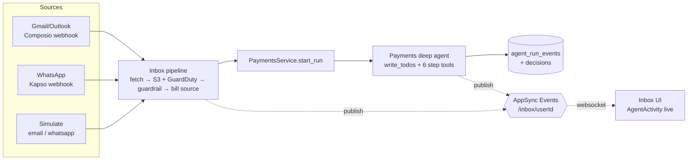

# Realtime agent inbox, WhatsApp bills and a planning payments agent

> "Finally, an agent that writes its own to-do list before deciding not to pay you. Live. On WhatsApp."
> - El Barto

## Overview

**Request**: Push agent state to the frontend with AWS AppSync (tool runs, status, todos) so the inbox feels alive. Add WhatsApp (via Kapso) as a new bill source: users connect their own number, or use the Kapso sandbox by default. Only PDF/ZIP/XML documents count. Remove the orchestrator agent, have triggers run the payments agent directly, and give that agent the deepagents `write_todos` planning tool.

**Created**: 2026-10-17

## What

1. **Realtime inbox (AppSync Events).** The backend publishes events to one channel per user, `/inbox/{userId}`:
   - inbox item status
   - run steps
   - agent tool start/finish, with friendly randomized Spanish messages
   - `write_todos` plan snapshots
   - coalesced LLM "thinking" tokens

   The frontend subscribes with `aws-amplify` v6. The current fast polling becomes a 60 s safety refresh and only comes back while the socket is down.
2. **Payments deep agent.** The fixed pipeline becomes a `create_deep_agent` that plans with `write_todos` and calls the pipeline stages as tools: classify, extract, register, rules, checker, settle. The verdict still comes from the 18 deterministic rules plus the checker, so the agent orchestrates but cannot invent a verdict. If it ends without settling, the bill fails closed to human review.
3. **WhatsApp source (Kapso).** WhatsApp works in two modes:
   - **Sandbox (default):** the user registers their phone and forwards PDFs to the shared Kapso sandbox number.
   - **Own number (opt-in):** a Kapso setup link with coexistence or dedicated connection, and an auto-registered webhook.

   WhatsApp documents go through the same evidence, guardrail and payments pipeline as email attachments.
4. **Orchestrator removal.** Remove the chat agent, chat/diagnostics routes, sessions, hello-world tools and the agent Postgres DB.

## Why

- A payments agent people can trust needs to be seen working. Watching the plan, each tool and each rule as it happens is the trust story of the hackathon.
- Latin American vendors and contractors send invoices over WhatsApp far more than over email.
- The orchestrator is dead weight: no trigger goes through it. Removing it shrinks the surface and the infra (one fewer Postgres).

## Impact

- **Backend:**
  - 3 new modules: `realtime`, `whatsapp_gateway`, and the payments agent files.
  - 1 module deleted (`orchestrator`), plus sessions and tools.
  - The inbox pipeline becomes multichannel.
  - 3 Alembic migrations.
- **Infra:** a new `infra/realtime.tf` (AppSync Events API, namespace, API key, IAM publish policy).
- **Frontend:** new dependency `aws-amplify`, a realtime hook, `AgentActivity` replacing `RunTimeline`, a WhatsApp connection card, a callback page, a source filter and neutral copy.
- **Docker:** `postgres-agent` is removed.

## Flow



```
Agent run, as the user sees it live:
  [plan]  ☐ Clasificar  ☐ Extraer  ☐ Registrar  ☐ Reglas  ☐ Verificador  ☐ Liquidar
  ▸ "Leyendo la factura para entender qué es…"            ✓ 1.2s
  ▸ "Sacando monto, moneda y beneficiario del PDF…"        ✓ 3.4s
  ▸ "Comparando contra las 18 reglas de la empresa…"       ✓ 0.1s
  … pensando: "El monto supera el auto-pago, debo…"
  → Decisión: En revisión
```
