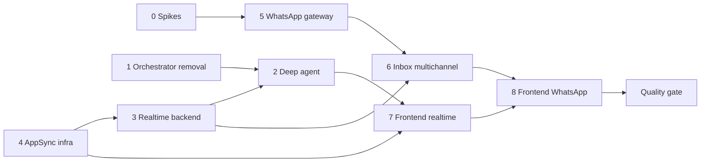

# Implementation Tasks

## Task Breakdown

### 0. Spikes (do first, ~30 min)
- [x] Kapso: try the legacy sandbox-session API, send a PDF to the sandbox number with a test webhook, and check that the `media_url` download works with `X-API-Key`. Record the results in `05-whatsapp-kapso-backend/spec.md` under "Spike results".
- [x] AppSync: after the first `terraform apply` (task group 4), confirm the `dns["HTTP"]` / `dns["REALTIME"]` keys. _(confirmed: HTTP and REALTIME)_

### 1. Orchestrator removal (`01-orchestrator-removal`)
- [x] Delete the chat and diagnostics routers and unregister them in `api/routers/__init__.py`.
- [x] Delete the orchestrator module and client, `contracts/chat.py`, and the `AgentProviderError` handler.
- [x] Delete the tools module, client and contracts (hello-world).
- [x] Delete the `main_agent` and `hello_world` prompts. Update `PromptId` and the registry together with `PAYMENTS_AGENT` (task group 2).
- [x] Delete the sessions module, client and contracts, and the `SessionMissingError` handler. Remove `session_id` from payments (trigger, service, client, repository, runner, model).
- [x] Drop the agent DB: `Checkpointers`, `Pools`, `Settings.agent_database_url`, `docker-compose` `postgres-agent`, `.env.example`.
- [x] Clean up `container.py` wiring.
- [x] Migrations: product (drop `agent_runs.session_id` and `sessions`); payments (drop `session_executions`, with no `checkpoint*` ops).
- [x] Run the grep gate from the spec, then `ruff check` and an import smoke test.

### 2. Payments deep agent (`02-payments-deep-agent`)
- [x] `RunState` dataclass.
- [x] Six no-argument step tools with preconditions and structured summaries (`agent_tools.py`).
- [x] `PAYMENTS_AGENT` prompt and registry entry.
- [x] `build_payments_agent` with `TodoListMiddleware` and a harness profile. Assert the tool set is exactly the 6 tools plus `write_todos`.
- [x] `stream_agent` mapping `astream_events` v2 to the recorder (todos, tool start/finish, thinking, summary).
- [x] Rewrite `runner.run_execution`, with `_run_agent` and `_finalize` (fail closed / `agent_incomplete`).
- [x] Wire `checkpointer` and `realtime` into `PaymentRunDependencies`.
- [x] Self-check for the `_finalize` branches.

### 3. Realtime backend (`03-realtime-backend`)
- [x] `contracts/realtime.py`, `RealtimeSettings`, and the `.env.example` section.
- [x] `modules/realtime`: AppSync SigV4 backend, null backend, service (chunks of 5, never raises), client, container wiring.
- [x] `RunsRepository.insert_event` returns the row (with `id`). Raise the event list limit to 300. Add `PaymentRunEvent.id`.
- [x] `RunEventRecorder` and `ThinkingBuffer` (`modules/payments/events.py`).
- [x] Spanish phrase catalog per tool and step (`modules/payments/phrases.py`).
- [x] `InboxNotifier`, called after every inbox status mutation and on new items.
- [x] Self-check for chunking and swallowed errors.

### 4. AppSync infra (`04-appsync-infra`)
- [x] `infra/realtime.tf`: Events API, `inbox` namespace (IAM publish / API key subscribe), API key.
- [x] IAM publish policy document attached to `var.backend_iam_user`, reusable for an instance role later.
- [x] Variables, outputs (sensitive key), and the provider `>= 6.9` constraint.
- [x] `terraform apply`, then fill in `backend/.env` and `frontend/.env.local`.

### 5. WhatsApp gateway (`05-whatsapp-kapso-backend`)
- [x] `contracts/whatsapp_gateway.py` and `KapsoSettings` (+ `.env.example`).
- [x] Pure helpers in `kapso.py`: `normalize_phone`, batch unwrapping, `document_event` filter.
- [x] `WhatsAppGatewayService`:
  - customer, setup link, phone verification, webhook registration, sandbox session;
  - `parse_webhook` with HMAC check;
  - `fetch_message` / download with a media-id fallback.
- [x] Client, container wiring, and error → HTTP mappings.
- [x] `scripts/bootstrap_kapso.py` (sandbox id plus idempotent webhook registration).
- [x] Self-check for the signature, payload and phone helpers.

### 6. Inbox multichannel (`06-inbox-multichannel`)
- [x] `MailProvider.WHATSAPP`, `SOURCE_TYPE_BY_PROVIDER`, `PROVIDERS_BY_SOURCE`, and the connection contract fields.
- [x] `mailbox_connections`: `mode`, `phone_number`, `external_ref` columns and the partial unique index, plus a migration.
- [x] Repository: sandbox lookup, Kapso customer lookup, account update, sandbox expiry, list filter.
- [x] Pipeline: dispatch `WhatsAppDocumentEvent` in `_resolve_email`; derive `source_type` in `_bill_source_intake`.
- [x] Service: `register_whatsapp_sandbox`, `start_whatsapp_connection`, `confirm_whatsapp_connection`, `ingest_whatsapp_webhook`, `simulate(channel)`, `source_type` in views.
- [x] Routers: 3 WhatsApp endpoints, `?source=` on emails, `POST /webhooks/whatsapp`.
- [x] Add `WHATSAPP` to `WHOLE_CONTENT_HASHED_SOURCES`.

### 7. Frontend realtime (`07-frontend-realtime`)
- [x] Add `aws-amplify@6.22.2` and the env vars to `.env.example`.
- [x] `lib/realtime.ts` and the `useInboxChannel` hook (reconnect with jitter); `currentUserId()`.
- [x] Inbox page: route events, adaptive polling (60 s live / 4–15 s offline), resync on connect.
- [x] `AgentActivity` (plan checklist, tool feed, thinking line, collapsed summary). Delete `RunTimeline`.
- [x] `EmailDetail` uses `AgentActivity` while pending and collapsed after the decision.
- [x] Types and labels for the new steps.

### 8. Frontend WhatsApp (`08-frontend-whatsapp`)
- [x] Types and API functions for the WhatsApp endpoints, the source filter and the simulate channel.
- [x] `WhatsAppCard`: sandbox default, phone registration, activation code or manual fallback, "Conectar mi número".
- [x] `/inbox/whatsapp/callback` page.
- [x] Simulated WhatsApp entries in the simulate menu.
- [x] Source filter chips.
- [x] Channel-neutral copy.

### Post-Implementation Quality Gate
- [x] Run a two-subagent quality pass over the recently-applied change:
  - [x] **Bug sweep:** launch a subagent to search the modified code for possible bugs, issues and inconsistencies (logic errors, edge cases, broken contracts, dead code, regressions). Report concrete findings as `file:line` references.
  - [x] **Polish:** launch a subagent that invokes the `codebase-change` skill and applies the polish DIRECTLY to the changed files:
    - delete unnecessary comments and make the code self-explanatory;
    - give every variable an obvious purpose;
    - maximize readability and maintainability, and remove unnecessary complexity;
    - resolve any real issues the bug sweep surfaced.

## Task Order

Groups 1, 4, 5 and the spikes can run in parallel. Group 3 can start against `NullRealtimeBackend` before infra exists.
